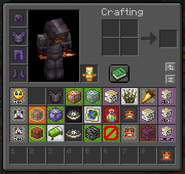
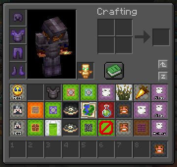
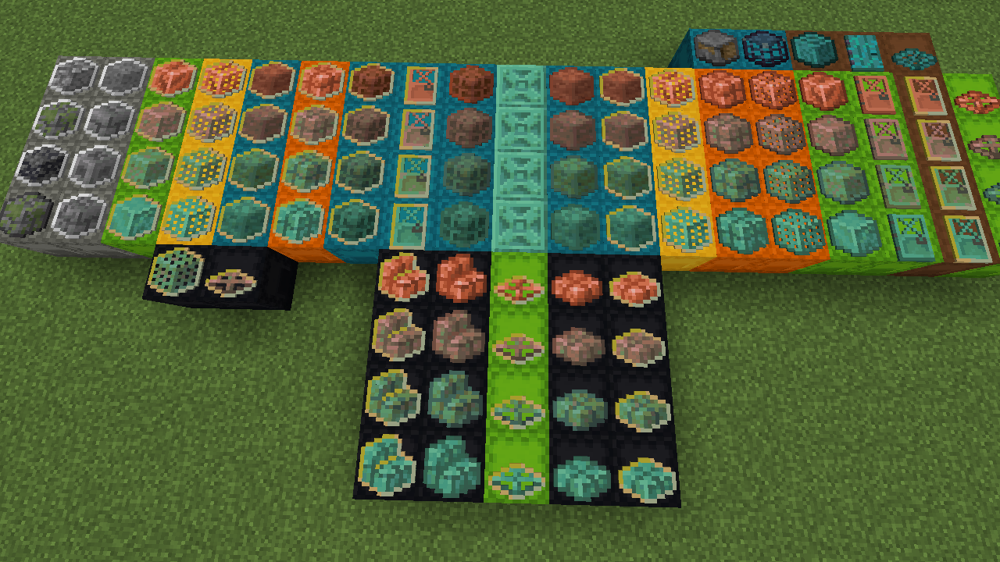
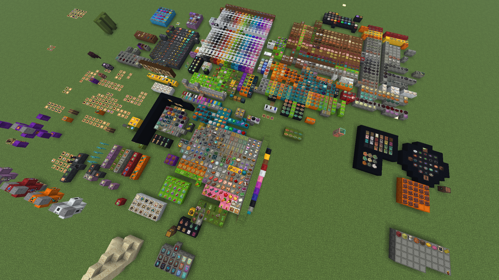

Peek flat shulker icons
=======================

Perfect addition to [Peek](https://www.curseforge.com/minecraft/mc-mods/peek)
mod to theme your shulker boxes with a flat pixelly look. I made this to
improve readability of my own cluttered inventory, and to assist finding
shulkers littered throughout my base and storage. If you like it, don’t like
it, want changes, let me know.

Features
--------

- Mostly high-quality textures!
- A more cohesive visual style!
- Differentiation between otherwise identical blocks, like a shiny finish on the waxed copper items!
- Neat animations!

Preview
-------

Sometimes you just pile shulkers against a wall for project planning…:

With | Without
--- | ---
 | 

Recently added new blocks:

We support disabling animations and armour parts of the resourcepack with [respackopts](https://www.curseforge.com/minecraft/mc-mods/respackopts)

Author’s test world for verifying everything is working as intended

Installation
------------

[Download from GitHub](https://github.com/johndrinkwater/peek-flat/releases/latest)
or get it from
[CurseForge](https://www.curseforge.com/minecraft/texture-packs/peek-flat-shulker-icons).
Put it in your `resourcepacks` folder (`%AppData%\.minecraft\resourcepacks` on
Windows, `~/Library/Application Support/minecraft/resourcepacks` on macOS, or
`~/.minecraft/resourcepacks` on Linux) and apply it in-game.

Feedback
--------

If you find any issues or have suggestions, make a new issue
[here](https://github.com/johndrinkwater/peek-flat/issues).

Rationale
---------

How do I decide what a block should look like? If a change is better or worse?
We prefer to closely match Minecraft textures where useful, prefer the block
appearance over ortho projection, but when complexity or readability suffers,
we do things differently. We use 14×14 icons so when using ‘flat shulker icon
(builtin)’ resource pack from Peek, you can comfortably see it as a shulker
with icon. When an item has a 3d appearance in game, we prefer to render the
icon as that, thus things like turtle & sniffer eggs look different. When the
in-game texture is OK, we use that - like tools etc.

Nothing is set in stone, and I am comfortable changing our existing icons if I
find a better way to convey that meaning.

Other Stuff
-----------

This work heavily builds upon
https://github.com/ThePotatoKing55/2D-block-texture-pack and
https://github.com/Thanos1716/2d-block-item-resourcepack which were inspired by
stiw91's [Flat - 2D Items](https://www.planetminecraft.com/texture-pack/flat-4806298/)

Optional dependency on [Respackopts](https://www.curseforge.com/minecraft/mc-mods/respackopts), which exposes pack settings
